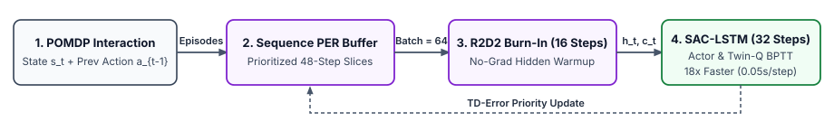
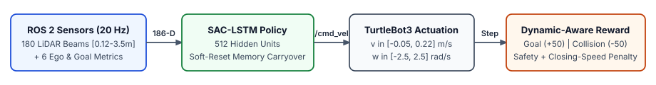
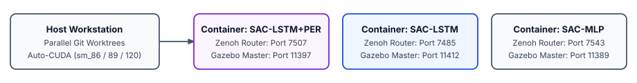

# Distributed Recurrent Deep RL (SAC-LSTM + R2D2 Burn-In) for Dynamic Mapless Navigation

<p>
  <a href="https://docs.ros.org/en/humble/"></a>
  <a href="https://gazebosim.org/"></a>
  <a href="https://pytorch.org/"></a>
  <a href="https://arxiv.org/abs/1812.05905"></a>
  <a href="https://openreview.net/forum?id=r1lyNpVuY7"></a>
  <a href="https://github.com/ros2/rmw_zenoh"></a>
</p>

Mapless navigation among moving obstacles is a **Partially Observable Markov Decision Process (POMDP)**: a single 2D LiDAR scan measures obstacle positions, not velocities. This repository solves continuous mapless navigation without pre-built maps using **Recurrent Soft Actor-Critic (`SAC + LSTM`)**, **R2D2 Sequence Burn-In**, and **Prioritized Experience Replay (`PER`)** in **ROS 2 Humble & Gazebo** through three core contributions:

1. **Custom PyTorch Recurrent RL Engine (`SAC + LSTM + R2D2 Burn-In + PER`):** Eliminates stale LSTM hidden-state drift during off-policy replay via sequence burn-in (`L_burn = 10`, `L_train = 20`) and a vectorized zero-copy sequence replay buffer (**~18× faster GPU updates**, **+45% higher return** on velocity-masked PO-MuJoCo & POPGym benchmarks).
2. **Dynamic-Aware Mapless Navigation Control & Reward Shaping:** Fuses `180-D` 2D LiDAR with robot kinematics into a `186-D` POMDP observation space and introduces closing-speed anticipation (`v_close`) + quadratic safety zone shaping, achieving **100% static** and **80% dynamic** zero-shot obstacle avoidance in Gazebo.
3. **Zero-Conflict Distributed Simulation Infrastructure:** Isolates parallel **ROS 2 Humble + Gazebo** training/evaluation containers on a single multi-GPU workstation via `rmw_zenoh_cpp` localhost-only routing and deterministic workspace-path port hashing (`ROS_DOMAIN_ID`, `GAZEBO_MASTER_URI`, `ZENOH_PORT`).

> **Documentation:** [**Algorithmic Theory & Reward Equations**](docs/METHODOLOGY_AND_THEORY.md) | [**Setup, Worktrees & Troubleshooting**](docs/SETUP_AND_TROUBLESHOOTING.md)

---

## 1. Recurrent RL Architecture & POMDP Validation

**Claim:** Combining `SAC + LSTM` with **R2D2 Sequence Burn-In** and **Sequence PER** resolves partial observability where `SAC-MLP` fails, while cutting GPU batch update latency by **~18× (`0.90s → 0.05s`)** and improving continuous-control sample efficiency by **+45%**.



> 📐 *POMDP formulation & R2D2 sequence burn-in theory:* **[`docs/METHODOLOGY_AND_THEORY.md#1-pomdp-formulation--recurrent-sac-architecture`](docs/METHODOLOGY_AND_THEORY.md#1-pomdp-formulation--recurrent-sac-architecture)**

### Proof A — POPGym Memory Benchmark (78 Runs, Velocity Masked)

| Task | Difficulty | `SAC + LSTM + PER` (Ours) | `SAC + LSTM (Uniform)` | `SAC + MLP` (Memoryless) | Steps |
| :--- | :---: | :---: | :---: | :---: | :---: |
| **RepeatPrevious** | Easy | **1.00 (Solved)** | **1.00 (Solved)** | — | ~255K |
| **PositionOnlyCartPole** | Easy | **0.90** | 0.70 | 0.20 | ~110K |
| **PositionOnlyCartPole** | Medium | **0.70** | 0.60 | 0.10 | ~115K |
| **HigherLower** | Easy / Med | **0.50** | **0.50** | — | ~255K |

> 📄 *Full per-seed POPGym results:* **[`docs/METHODOLOGY_AND_THEORY.md#41-popgym-memory-benchmark-78-runs`](docs/METHODOLOGY_AND_THEORY.md#41-popgym-memory-benchmark-78-runs)**

### Proof B — PO-MuJoCo Continuous Control Benchmark (3M Steps, Velocity Masked)

| Algorithm Variant | HalfCheetah-v4 (PO) — Seed 42 / 123 / 456 | HalfCheetah Mean | Ant-v4 (PO) — Seed 42 / 123 / 456 | Ant Mean |
| :--- | :---: | :---: | :---: | :---: |
| **`SAC + LSTM + PER` (Ours)** | **14,900** / **7,900** / **12,709** | **11,836 (+44.7%)** | **3,501** / **3,392** / **1,822** | **2,905 (+48.4%)** |
| `SAC + LSTM + Uniform` | 9,201 / 7,422 / 7,921 | 8,181 | 1,791 / 2,461 / 1,623 | 1,958 |

> 📄 *Full PO-MuJoCo breakdown & benchmark details:* **[`docs/METHODOLOGY_AND_THEORY.md#42-po-mujoco-continuous-control-benchmark-3m-steps-velocity-masked`](docs/METHODOLOGY_AND_THEORY.md#42-po-mujoco-continuous-control-benchmark-3m-steps-velocity-masked)**

---

## 2. Dynamic-Aware Mapless Robot Navigation (ROS 2 + Gazebo)

**Claim:** A single `SAC + LSTM + PER` policy trained on Stage 4 with **closing-speed anticipation** and **quadratic safety shaping** generalizes zero-shot across static stages (**100% success**) and dynamic moving obstacles (**80% success**).



> 📐 *State/action spaces & dynamic-aware reward equations:* **[`docs/METHODOLOGY_AND_THEORY.md#2-observation--action-spaces-srcenvspgrc_env_map_goalpy`](docs/METHODOLOGY_AND_THEORY.md#2-observation--action-spaces-srcenvspgrc_env_map_goalpy)** & **[`#3-dynamic-aware-reward-function`](docs/METHODOLOGY_AND_THEORY.md#3-dynamic-aware-reward-function)**

### Proof — Multi-Stage Gazebo Evaluation (Single Stage-4 Trained Policy)

| Metric | `turtlebot_world` | Stage 1 (Static) | Stage 2 (Static) | Stage 3 (Fixed-Path Obs.) | Stage 4 (Static) | Stage 4 (Dynamic Moving Obs.) |
| :--- | :---: | :---: | :---: | :---: | :---: | :---: |
| **Eval Episodes** | 100 | 50 | 50 | 50 | 50 | 50 |
| **Success Rate (%)** | **78.0%** | **100.0%** | **100.0%** | **46.0%** | **100.0%** | **80.0%** |
| **Collisions / Timeouts** | 22 / 0 | **0 / 0** | **0 / 0** | 27 / 0 | **0 / 0** | 10 / 0 |
| **Mean Reward** | 34.62 | 76.72 | 70.39 | 2.66 | 66.73 | 44.02 |
| **Min / Max Reward** | -67.8 / 70.5 | 59.1 / 100.6 | 55.5 / 87.6 | -55.2 / 72.2 | 54.9 / 83.7 | -54.4 / 77.8 |
| **Mean Steps (Succ.)** | 166.4 | 286.4 | 245.1 | 138.2 | 239.1 | 250.7 |

---

## 3. Zero-Conflict Distributed Container Infrastructure

**Claim:** Deterministic hash-based port allocation and hardware-aware CUDA setup allow parallel ROS 2 + Gazebo containers (`SAC-LSTM+PER`, `SAC-LSTM`, `SAC-MLP`) to train simultaneously on one workstation with zero topic cross-talk.



> 🛠️ *Port isolation formula, parallel Git Worktrees & troubleshooting:* **[`docs/SETUP_AND_TROUBLESHOOTING.md`](docs/SETUP_AND_TROUBLESHOOTING.md)**

---

<details>
<summary><b>📁 Repository Structure (Click to expand)</b></summary>

```text
Mapless-RL-Navigation/
├── .devcontainer/              # Isolated ROS 2 Humble + Gazebo 11 + Zenoh Dockerfile
├── .scripts/                   # Auto-GPU PyTorch installer, colcon builder, tmux launcher
├── docs/
│   ├── METHODOLOGY_AND_THEORY.md     # Detailed RL math, burn-in theory & per-seed tables
│   ├── SETUP_AND_TROUBLESHOOTING.md  # DevContainer, Git Worktrees & ROS 2 troubleshooting
│   └── media/                        # Visual benchmark GIFs & videos
├── src/
│   ├── config/config.py        # Centralized environment, reward & SAC-LSTM hyperparameters
│   ├── envs/                   # ROS 2 Gazebo Gymnasium env & entity pose/goal reset node
│   ├── sac_agent/              # Recurrent SAC-LSTM, SAC-MLP & Sequence PER buffers
│   ├── train/                  # Asynchronous SAC-LSTM & SAC-MLP training entrypoints
│   ├── evaluate/               # Autonomous multi-episode checkpoint evaluation suite
│   ├── benchmark/              # Parallel Gazebo runner, POPGym & PO-MuJoCo suites
│   └── tools/                  # Real-time LiDAR sector & observation visualizers
└── requirements.txt
```

</details>

<details>
<summary><b>🚀 Quickstart & Training (Click to expand)</b></summary>

```bash
# 1. Build isolated DevContainer & launch tmux session
devcontainer up --workspace-folder . --remove-existing-container --build-no-cache
devcontainer exec --workspace-folder . bash -lc '/workspaces/Mapless-RL-Navigation/.scripts/start_tmux.sh'

# 2. [Window 1: tb3setup] Launch Gazebo Stage 4 (Dynamic Moving Obstacles)
export TURTLEBOT3_MODEL=burger
export GAZEBO_PLUGIN_PATH=/opt/turtlebot3_ws/build/turtlebot3_gazebo:/opt/turtlebot3_ws/src/turtlebot3_simulations/turtlebot3_gazebo/worlds/plugins
ros2 launch turtlebot3_gazebo turtlebot3_dqn_stage4_moving_obs.launch.py gui:=false

# 3. [Window 2: tb3venv1] Start pose & curriculum goal manager
python3 src/envs/gazebo_initial_pose_node_for_all_models.py

# 4. [Window 3: tb3venv2] Train or Evaluate SAC-LSTM + PER
__NV_PRIME_RENDER_OFFLOAD=1 __GLX_VENDOR_LIBRARY_NAME=nvidia python3 src/train/train_lstm.py --train
__NV_PRIME_RENDER_OFFLOAD=1 __GLX_VENDOR_LIBRARY_NAME=nvidia python3 src/train/train_lstm.py --test --model_path ./models/sac_lstm_checkpoints/best_eval_model_ep_500

# 5. Run parallel multi-container benchmarks across seeds
python3 -m benchmark.runner --mode parallel --experiments sac_lstm_per sac_lstm sac_mlp --seeds 42 123 456
```

</details>

<details>
<summary><b>🛠️ Detailed Setup, Theory & Troubleshooting Guides (Click to expand)</b></summary>

- **[`docs/METHODOLOGY_AND_THEORY.md`](docs/METHODOLOGY_AND_THEORY.md)** — POMDP formulation, R2D2 sequence burn-in math, observation/action normalization, dynamic-aware reward equations, and full per-seed POPGym breakdown tables.
- **[`docs/SETUP_AND_TROUBLESHOOTING.md`](docs/SETUP_AND_TROUBLESHOOTING.md)** — DevContainer CLI installation (NVM / APT), parallel **Git Worktree** experiment management, deterministic Zenoh/Gazebo port inspection, live `gzclient` GUI attachment, and ROS 2 / X11 troubleshooting.

</details>
